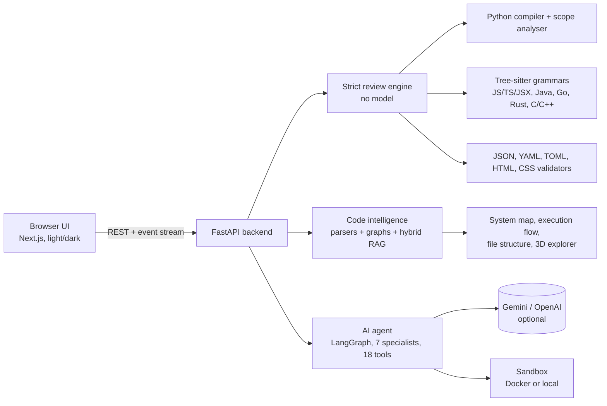
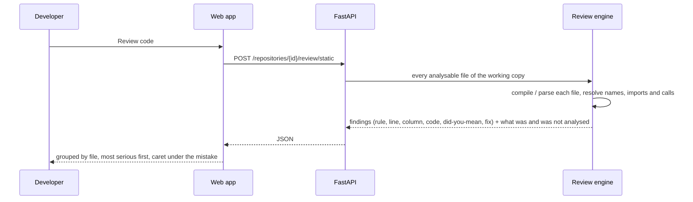

<div align="center">

# CodeScout AI

### AI-Powered Automated Code Review

**Finds the real mistakes in your code in about a second: typos, undefined names, wrong imports, wrong function calls, broken syntax and security holes. Then an AI agent explains them, fixes them and proves each fix with your tests.**

</div>

---

## 1. Project title and problem statement number

| | |
|---|---|
| **Project title** | **CodeScout AI**: AI-Powered Automated Code Review |
| **Event** | Neural Storm 2026 (AI/ML hackathon) |
| **Track** | Track 1: Future Tech, Intelligent Systems & Emerging Technology |
| **Problem statement number** | **FT-05: AI-Powered Automated Code Review** |

## 2. Team name and member names

| | |
|---|---|
| **Team name** | _(add your team name here)_ |
| **Members** | Santosh Suresh Madannavar ([@Santosh02411](https://github.com/Santosh02411)) _(add the other members)_ |

## 3. Problem description and proposed solution

### The problem
Reviewing code is slow, and the cheap mistakes (a misspelled variable, an import path with a typo, a function called with the wrong number of arguments, a missing brace) waste a reviewer's time and still reach production. Reviewers that rely on a language model are fast but can invent problems, miss real ones, and give no way to tell which is which. Developers need a reviewer they can **trust for the things a machine can be certain about**, and an assistant for the rest.

### The solution
CodeScout AI reviews a whole project in seconds with two layers:

1. **Strict review (deterministic, no AI model).** Python is compiled with Python's own compiler and analysed with a scope-aware checker; JavaScript, TypeScript, JSX/TSX and five more languages are parsed with Tree-sitter grammars; JSON, YAML, TOML, HTML and CSS are validated. Every finding has a rule id, severity, exact line and column, the offending code with a caret, a **"did you mean…?"** suggestion and a how-to-fix. It reads **every file** and states what it covered and what it cannot see.
2. **AI agent (optional).** Explains code with citations, finds root causes, writes patches, **runs your tests before and after** to mark a fix *verified* or *only suggested*, and reviews logic the static rules cannot judge. Nothing is applied to your project without your explicit approval.

### What the strict review catches

| Kind of mistake | Examples it finds | Rules |
|---|---|---|
| **Syntax** | missing `:`, unclosed or extra `(` `{` `[`, misspelled `retrun`, bad indentation, unterminated string, unclosed JSX expression, broken JSON/YAML/HTML | `PY-SYNTAX`, `JS-SYNTAX`, `TS/JAVA/GO/RS/C/CPP-SYNTAX`, `JSON-`/`YAML-`/`TOML-SYNTAX`, `HTML-UNCLOSED`, `BRACE` |
| **Typos and undefined names** | `itmes` → *did you mean `items`?*, `self.nmae`, `os.pth`, `useSate`, `<Hedaer />`, Python 2 leftovers (`xrange`) | `PY-UNDEFINED`, `PY-ATTR`, `PY-MODATTR`, `JS-UNDEFINED` |
| **Wrong imports** | a name or module that does not exist in the project, `import X from './Hedaer'`, a name the module does not export, a package missing from `package.json` (`reactt`) | `PY-IMPORT`, `JS-IMPORT`, `JS-EXPORT`, `JS-PACKAGE` |
| **Wrong calls** | too many / missing arguments, misspelled keyword argument, method without `self` | `PY-ARITY`, `PY-NOSELF` |
| **Bug patterns** | `x / 0`, `assert (cond, "msg")` (never fails), `'a' + 1`, mutable default argument, function defined twice, unreachable code, duplicate dict key, wrong number of `%s`, assignment in an `if`, empty `catch` | `PY-DIVZERO`, `PY-ASSERT`, `PY-TYPEMIX`, `PY-MUTDEF`, `PY-REDEF`, `PY-UNREACHABLE`, `PY-DUPKEY`, `PY-FORMAT`, `JS-ASSIGNCOND`, `JS-EMPTYCATCH` |
| **Security** | SQL built by string concatenation, `shell=True`, `yaml.load`, `pickle`, TLS verification off, hard-coded secrets and tokens, `eval` on dynamic input | `PY-SQLI`, `PY-SHELL`, `PY-YAML`, `PY-PICKLE`, `PY-TLS`, `SECRET`, `PY-EVAL` |
| **Dead code** | unused imports and variables | `PY-UNUSEDIMPORT`, `PY-UNUSEDVAR`, `JS-UNUSEDIMPORT` |

Full catalogue and design: [docs/REVIEW_ENGINE.md](docs/REVIEW_ENGINE.md).

### Impact
Cheap mistakes are the most common reason a review round is wasted. CodeScout AI catches them before a human looks, gives each one an exact location and a suggested fix, works **fully offline** (so private code never has to leave the machine for this layer), fits CI (`--fail-on high`, SARIF export for GitHub code scanning) and teaches as it reports (every finding says why).

## 4. Technology stack and libraries used

| Area | Technology and libraries |
|---|---|
| **Review engine** | Python `compile()` and `ast` (scope analysis), **Tree-sitter** (`tree-sitter` ≥ 0.23 with grammars for Python, JavaScript, TypeScript/TSX, Java, C, C++, Go, Rust), `json`, `PyYAML`, `tomllib`, `html.parser`, `difflib` (did-you-mean) |
| **Backend** | Python 3.11+, **FastAPI** ≥ 0.110, Uvicorn, Pydantic ≥ 2.6, python-multipart, python-dotenv, httpx, NumPy |
| **AI agent** | **LangGraph** ≥ 0.2, langchain-core ≥ 0.3, **Gemini** (`google-genai`) or **OpenAI** (`openai`) behind one interface with an offline mock; hybrid retrieval (vectors + BM25 + reranking); optional PostgreSQL + pgvector (`psycopg`, `pgvector`) |
| **Code intelligence** | Tree-sitter + `ast`, call / import / inheritance graphs, system graph, execution-flow extraction |
| **Execution / safety** | Docker sandbox (no network, read-only filesystem) or local mode; `ruff` for linting; `pytest` |
| **Frontend** | **Next.js 14**, React 18, TypeScript, Tailwind CSS, Radix UI, `@monaco-editor/react`, **React Flow** (`reactflow`), **React Three Fiber** (`three`, `@react-three/fiber`, `@react-three/drei`), Recharts, Framer Motion, TanStack Query, Zustand, `react-markdown` + `highlight.js`, Sonner, Lucide icons |

Exact dependency lists: [requirements.txt](requirements.txt) and [frontend/package.json](frontend/package.json).

## 5. Setup and installation instructions

**Requirements:** Python 3.11 or newer. Node.js 18+ is needed only to rebuild the web interface (a built copy is included in `app/webapp`). Docker is optional (isolated test execution).

```bash
# 1. get the code
git clone <this repository> codebase-agent
cd codebase-agent

# 2. create an environment and install the Python dependencies
python -m venv venv
source venv/bin/activate            # Windows: venv\Scripts\activate
pip install -r requirements.txt

# 3. create your settings file (works as it is: offline mode, no API key needed)
cp .env.example .env                # Windows: copy .env.example .env
```

**Optional: turn on the AI features.** Open `.env`, set `LLM_PROVIDER=gemini` (or `openai`) and the matching key (`GEMINI_API_KEY=…`), then restart. How to get each key, and what happens if a key is missing: [docs/ENV_SETUP.md](docs/ENV_SETUP.md). The strict code review never needs a key.

**Optional: rebuild the web interface** after changing `frontend/`: `scripts/build_frontend.sh` (Node 18+). For hot-reload development: `cd frontend && npm install && npm run dev`.

## 6. Instructions for running the project locally

```bash
uvicorn app.main:app --reload       # then open http://localhost:8000
```

1. Click **Add project** and choose a GitHub URL, a ZIP, or a local folder (local folders need `ALLOW_LOCAL_PATHS=true`, already set in `.env.example`).
2. Click **Review code** (second item in the sidebar, and on the dashboard). Results appear in about a second.
3. Open any finding to see the code with a caret under the mistake and how to fix it.
4. Explore **Architecture** (system map, execution flow, file structure, 3D map) and **Paste code** (review code with no project).

**Try it right now with the included demo projects** (each has deliberate mistakes listed in [examples/README.md](examples/README.md)):
```bash
python -m app.review examples/python-demo --fail-on never
python -m app.review examples/react-demo  --fail-on never
```

**Your edits and the server's copy.** The app reviews its own copy of a project. After you change files in your original folder, use **Sync & review again** (or project menu → *Sync from source & re-index*). A project imported from a ZIP must be imported again.

**Use it in CI or as a commit check**
```bash
python -m app.review . --fail-on high              # exit status 1 if any high-severity finding exists
python -m app.review . --sarif > review.sarif      # upload to GitHub code scanning
python -m app.review . --markdown > REVIEW.md
```
The web app exports the same reports (Code Review → **Export report**: Markdown, SARIF, JSON).

**Tests:** `pytest` (offline: no keys, no network, no Docker needed).

## 7. Screenshots

Every screenshot below was taken from the running application on a real open-source project, [miguelgrinberg/microblog](https://github.com/miguelgrinberg/microblog) (a Flask app, MIT licence, 52 Python files), into which **six realistic mistakes were planted** for the demonstration: a misspelled function name, a misspelled exception name, a call with a missing argument, an import of a name that does not exist, a missing colon, and a hard-coded API token. The same files are in the [Screenshots](Screenshots/) folder.

### 7.1 The review: the main feature

**1. Dashboard with the Code Review card at the top.** Live summary of the review (files, high/medium/low counts, time) with the top findings and a **Review code** button.


**2. Code Review: every finding, grouped by file, most serious first.** Rule id, line and column, filters, and an honest summary of what was analysed.


**3. One finding in detail.** The offending line with a caret under the mistake, a *did you mean…?* suggestion and how to fix it.


**4. "What was analysed".** Per language, what was checked, which files were skipped and why, and what static analysis cannot see.


**5. Paste code review.** Review code without a project; the example shows typical mistakes being caught.


### 7.2 Understanding the project

**6. System map.** One box per code folder, one labelled arrow per pair of folders (what is imported or called), selection highlights connections.


**7. Execution flow, sequence diagram.** What a route handler calls, in source order, across files.


**8. Execution flow, flowchart.** The same flow as a top-to-bottom chart.


**9. File structure.** The complete project tree annotated with entry points, tests and usage.


**10. 3D architecture explorer.** The real parsed graph: folders, files, imports and calls; selecting a file lists exactly what it uses and what uses it (verified and inferred relationships are marked).


### 7.3 Tests, overview and themes

**11. Testing.** Discovered tests are shown separately from executed results; nothing is ever shown as passed unless a test run really executed.


**12. Dashboard: architecture at a glance, starting questions, risks.**


**13. Light theme.** A complete light palette (the interface also has a full dark theme, shown above).


## 8. Model accuracy and performance metrics

All numbers come from this repository's own harness and can be reproduced: `python -m app.review.bench --corpus app frontend/src`. Full report: [eval/results/review_benchmark.md](eval/results/review_benchmark.md).

| Measurement | Result |
|---|---|
| Seeded mistakes (54 hand-written cases: 38 Python, 12 JavaScript/React, 4 data/markup) | **54 of 54 found (100%)**; **53 on exactly the right line (98%)** |
| False alarms on 6 known-good programs (classes, closures, dataclasses, hooks, JSX, constants named like secrets…) | **0** at high/medium severity |
| Untouched third-party project (`microblog`, 52 Python files) | **0 high-severity findings**; 5 medium (genuine `os.system()` calls) |
| Same project with 6 planted mistakes | **all 6 found** (6 high), 84 ms |
| This project's own 130-file Python backend | **0 high**, 4 medium (all genuine `except: pass` blocks) |
| This project's own 118-file React/TypeScript frontend | **0 high, 0 medium** |
| Speed | about 130 files in 1.7 s; a 52-file project in under 100 ms; a small project in under 20 ms |
| Automated tests | run `pytest` (offline; covers the review engine, benchmark, agent, API and sandbox) |

**How to read these numbers.** The seeded cases were written by the authors from mistakes developers really make; they are a regression suite and a yardstick for *this* engine, **not** a comparison with other tools. No accuracy figure is claimed for the optional AI agent's patches: that needs a real model and has not been measured (`python -m app.rag.eval agent`). Building the clean-code check found and fixed real false alarms along the way, which is why it is part of the benchmark.

## 9. Disclosure of AI development tools used

- **Claude (Anthropic)** was used throughout development to help write and review code, tests, documentation and diagrams, under the authors' direction and review.
- **ChatGPT, GitHub Copilot, Cursor or similar tools:** _(add here what you used, or write "none")_.
- **At runtime**, the strict review uses **no AI model**. The optional AI features call the model you configure (Gemini or OpenAI) and are labelled as model output; with no key the app runs in an offline mode and says so wherever an AI result would appear.

---

## How it works





**The AI agent's loop (optional):** *Understand → Plan → Research (hybrid search + call graph) → Analyze → Implement → Test → Review → Complete.* Every phase, tool call and timing shown in the UI comes from real events; phases that never ran are shown as "not needed". Details: [docs/AGENT.md](docs/AGENT.md), [docs/RAG.md](docs/RAG.md), [docs/SANDBOX.md](docs/SANDBOX.md).

## Everything in the app

| Page | What it does |
|---|---|
| **Dashboard** | Review card with a **Review code** button, AI project understanding (cited), architecture at a glance, starting questions built from your code, risks, agent activity |
| **Code Review** | Whole-project review, **paste-code review**, sync banner, exports, optional AI deep review |
| **AI Chat** | Explain / Debug / Review / Change / Test modes, `@file` references, citations that open the code, a live agent timeline |
| **Code Explorer** | File tree, Monaco editor, outline, callers/callees, search |
| **Architecture** | System map, execution flow, file structure, 3D map, folders, files, function calls, data models, tests-to-source, impact; "Explain this architecture" with AI |
| **Debugging** | Paste an error: root cause, patch preview, before/after tests, *verified* vs *suggested* fix |
| **Code Quality** | Score, 10 analyzers, coverage, trend |
| **Changes & Patches** | Exact diffs, per-file approval, apply, revert |
| **Testing** | Discovered vs executed tests, real output and tracebacks, recorded history |
| **GitHub & PRs** | Analyze/review pull requests, fix issues, approvals |

## Project layout
```
app/review/        strict review engine: pycheck.py, jscheck.py, treecheck.py, datacheck.py, engine.py, report.py, bench.py, __main__.py (CLI)
app/agent/         AI agent: nodes, specialists, tools, context, safety checks
app/intel/         parsers, code graphs, system graph, insights
app/llm/           Gemini / OpenAI / mock behind one interface
app/rag/           retrieval, embeddings, evaluation harness
app/webapp/        the built web interface served at http://localhost:8000
frontend/          web interface source (Next.js)
examples/          demo projects with deliberate mistakes
eval/              benchmark datasets and results
docs/              design docs, environment guide, demo script
Screenshots/       numbered screenshots used in this README
tests/             offline test suite
```

## Limitations (stated plainly)
- **No type checking.** Wrong argument *types* and return types are not detected (the Code Quality scan runs mypy for Python where available).
- **Logic errors** that are syntactically and semantically valid (a wrong formula, a wrong condition) cannot be found by static rules. The optional AI review looks for them, but its findings are model output and are labelled as such.
- **Depth varies by language.** Python is analysed deepest. JavaScript/TypeScript/React get syntax, import resolution, undefined names and pattern rules. Java, Go, Rust, C and C++ are checked for syntax errors only.
- **Dynamic code is skipped, not guessed:** names created with `exec`/`setattr`, star imports, bundler aliases (`@/x`) and globals from `<script>` tags.
- The AI agent's patch quality has not been benchmarked with a real model.
- One local user; add accounts before exposing the server on a network.

## Documentation
[docs/REVIEW_ENGINE.md](docs/REVIEW_ENGINE.md) (rules and design) · [docs/DEMO.md](docs/DEMO.md) (demo script) · [docs/ENV_SETUP.md](docs/ENV_SETUP.md) (keys) · [docs/AGENT.md](docs/AGENT.md) · [docs/RAG.md](docs/RAG.md) · [docs/SANDBOX.md](docs/SANDBOX.md) · [docs/BUILD_PLAN.md](docs/BUILD_PLAN.md) · [docs/PROGRESS.md](docs/PROGRESS.md) · [docs/FRONTEND_AUDIT.md](docs/FRONTEND_AUDIT.md) · [frontend/README.md](frontend/README.md)

## License
MIT. See [LICENSE](LICENSE).
